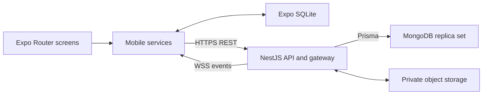

# ChatApp architecture

Status: accepted design for implementation. See the [architecture decision](ADR/0001-system-architecture.md), [baseline audit](PROJECT_AUDIT.md) and [stage gates](QUALITY_GATES.md).

## Components and data ownership

- **Expo + React Native:** TypeScript screens call application services for auth, chat, sync, uploads and settings. Message lists render from local state. Expo SQLite owns cached history, drafts, outbound jobs and sync cursors. SecureStore holds native refresh credentials. Keep short-lived access tokens in memory. Persist system/light/dark preference separately from credentials.
- **NestJS:** One modular service owns identity, profiles, conversations, messages, receipts, attachments and sync. REST under `/v1` handles reads and durable commands. A Socket.IO gateway over WebSockets handles authorized live fanout, typing and presence. REST and gateway share the same domain authorization rules. One NestJS instance is the initial deployment target. Horizontal scaling requires a shared adapter, distributed presence and coordinated publisher ownership.
- **MongoDB:** Prisma owns durable domain and sync writes. Use an Atlas or local replica set. Keep CLI and client on the same compatible version. MongoDB schema/index changes use reviewed `db push` and versioned data backfill scripts with explicit rollout and recovery steps.
- **Attachment bytes:** Store privately in an S3-compatible bucket. NestJS owns metadata, authorization, upload verification and short-lived access grants. Use a local S3-compatible development service when attachments land.
- **Desktop:** Electron joins the same API later. Share protocol types, queue rules and validation with a platform-specific persistence adapter. Use a restricted preload bridge and keep file access, durable storage and OS credential access in the main process.

## Canonical data model

| Record | Identity, indexes and invariants |
| --- | --- |
| User, Profile, Session | Unique normalized email. Public profile fields are allowlisted. Store password hashes and hashed rotating refresh tokens. Track session expiry and revocation. |
| Conversation, Membership | Unique direct chat via a separate direct-pair mapping keyed by sorted user IDs. Group creation and initial memberships commit together. Membership is unique per conversation/user and carries role, active status and visibility boundary. |
| Message | Unique `(senderId, clientMessageId)`. Index conversation plus server-assigned creation sequence for stable history paging. Store body, author, attachment references and deletion metadata. Keep a non-content request fingerprint for duplicate validation after deletion. |
| Receipt | Unique `(messageId, recipientId)`. Record eligible recipients at send time. Server-managed timestamps progress from delivered to read, with read implying delivered. |
| Attachment | Owner, conversation, generated object key, content metadata and lifecycle. Attach only verified objects scoped to the sender and conversation. |
| Sync event | Unique `(conversationId, sequence)` plus conversation/sequence query index. Persist message, receipt, deletion and membership changes atomically with domain writes. Keep event records free of message and attachment content and resolve current authorized state on delivery and replay. An account-scoped inbox change stream carries membership grants and revocations independently of conversation subscriptions. |

Use bounded groups for the initial release. Group member additions see history from their join boundary, and removal immediately revokes new server access and clears cached content when clients learn of removal. Previously viewed content or data on a disconnected device cannot be recalled remotely. An inbox index by user and active membership supplies the authorized conversation list.

## Request and sync flows

1. **Connect and authenticate.** Seed the base URL from public build configuration and allow a persistent override. Require HTTPS/WSS in distribution builds. Allow cleartext only by explicit development configuration. Validate the target API and protocol before switching. Close the old socket, clear credentials and switch to the new backend/account SQLite scope. A user must sign in again before that scope sends anything. Registration and login return scoped sessions. Refresh rotates the token, and sign-out revokes the session, clears sensitive state and locks pending work to its original account.
2. **Load and search.** Read the local inbox immediately, then reconcile over REST. Fetch history by stable keyset cursor. Server search is scoped to an authorized conversation and excludes tombstones. Use an indexed bounded term search with a deterministic secondary sort for the initial release. Local cached search, if shown offline, is labeled as such.
3. **Compose and commit.** SQLite atomically persists a bubble and outbox job with a client UUID before networking. A single worker claims eligible jobs with a recoverable lease. Use capped exponential backoff with jitter, resume on startup/foreground/connectivity recovery and keep failed content available. Harden durable attachment staging by copying picked files into app-owned storage before enqueue. Upload verification precedes message submission and reuses the same attachment identity after a retry. The outbox keeps the original immutable payload once an attempt begins.
4. **Send and retry.** `POST /v1/conversations/{id}/messages` validates membership and canonical payload. A successful transaction writes the message, recipient targets and sync event before returning the canonical message. On an identical idempotency replay, return the same authorized result. Handle concurrent unique-key races by rereading the winner. A reused key with a different request returns `409`. An expired session pauses draining while it refreshes. Permanent validation and membership errors produce a durable, actionable failure. A response lost after commit is safe to retry with the same key.
5. **Publish and recover.** A NestJS relay reads committed events from the durable log and checkpoints after dispatch. A crash before the checkpoint can produce duplicate dispatch, so clients merge idempotently. Clients reconcile inbox changes through the authenticated account stream and reconnect replay, including changes to conversations they were never subscribed to. The gateway authenticates the socket, validates subscription membership and emits only to eligible active sessions. On initial connect, reconnect and foreground, establish subscriptions, buffer live events while replaying REST deltas and advance each SQLite cursor atomically with contiguous applied changes. Initialize new memberships at their visibility boundary, and use cursor-only positions for filtered changes within the visible sequence range so a client can advance without receiving restricted payloads. Fetch a gap immediately when detected. On an expired cursor, take an authorized snapshot with a consistent high-water mark and preserve unsent outbox items. Reconcile inbox membership first and discard data from revoked conversations. Each emitted version is a high-water mark for that projection. Clients ignore older versions after a newer projection has been stored. A healthy connection does not periodically poll history.
6. **Acknowledge and delete.** After recipient persistence, send a delivered acknowledgment. Mark read only when the message is visible in the active chat. Persist receipt writes through REST with monotonic semantics and fan out their changes through the gateway. Only the original sender with active membership can soft-delete a message. Atomically mask content, revoke new attachment grants and append a tombstone event. Expire existing download grants quickly and clean up unreferenced bytes by policy. All clients discard deleted payloads from local caches and search.
7. **Presence and typing.** Track authenticated socket counts per user with heartbeat expiry and disclose presence only to users with an allowed chat relationship. Publish typing to an authorized conversation, throttle by user and clear it on stop, timeout or disconnect. Use ephemeral signals for both features.

| Outgoing status | Evidence required |
| --- | --- |
| Queued | Outbox and bubble persisted locally, waiting for a usable session or retry. |
| Sending | Worker holds an active send lease. |
| Sent | Canonical server commit confirmed by the response or reconciliation. |
| Delivered | At least one authorized device per eligible recipient has persisted and acknowledged it. |
| Read | Each eligible recipient has acknowledged reading it. A group shows per-recipient progress and counts as receipts arrive. |
| Failed | A permanent failure or exhausted retries require user action. The original content remains available. |

For group messages, the aggregate states apply to eligible send-time recipients who still have access. Removed recipients are marked ineligible for future totals, historical receipt timestamps are retained, and new members do not expand past targets. A group with zero eligible recipients remains sent. Duplicate or reordered updates never regress a receipt.

## Deployment boundaries

Use TLS, segregated environment secrets, strict payload validation, request IDs, redacted structured logs and health/readiness endpoints. Hash passwords with Argon2id using measured parameters. Apply limits to login, sync, typing and file size, configure an explicit origin allowlist where applicable, and keep MongoDB and storage credentials server-side. Track outbox age, duplicate replay counts, socket reconnects, sync lag and upload failures. Exclude message bodies, credentials and signed URLs from telemetry. Stage 8 verifies rate limits, storage policies, backup/restore and release builds. Stage 10 owns signed/notarized macOS distribution where credentials are available.

References: [Prisma MongoDB connector](https://www.prisma.io/docs/orm/v6/overview/databases/mongodb), [NestJS gateways](https://docs.nestjs.com/websockets/gateways), [Socket.IO delivery guarantees](https://socket.io/docs/v4/delivery-guarantees/), [Expo SQLite](https://docs.expo.dev/versions/latest/sdk/sqlite/) and [Expo SecureStore](https://docs.expo.dev/versions/latest/sdk/securestore/).
