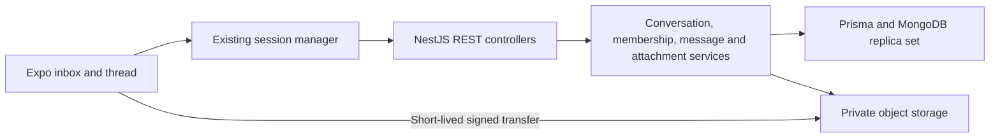
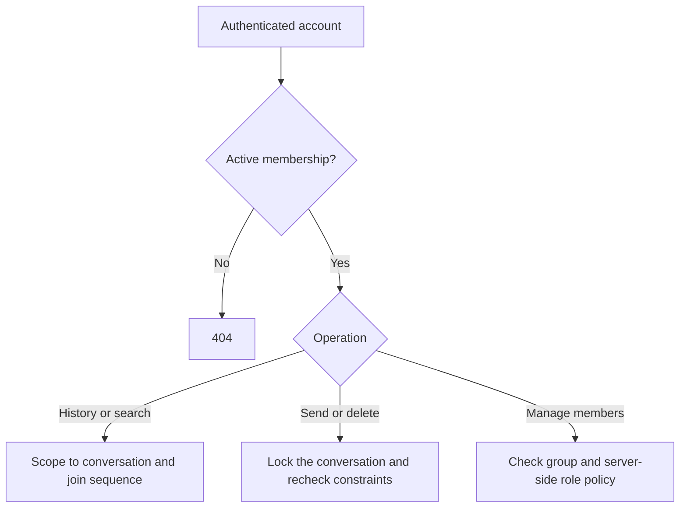
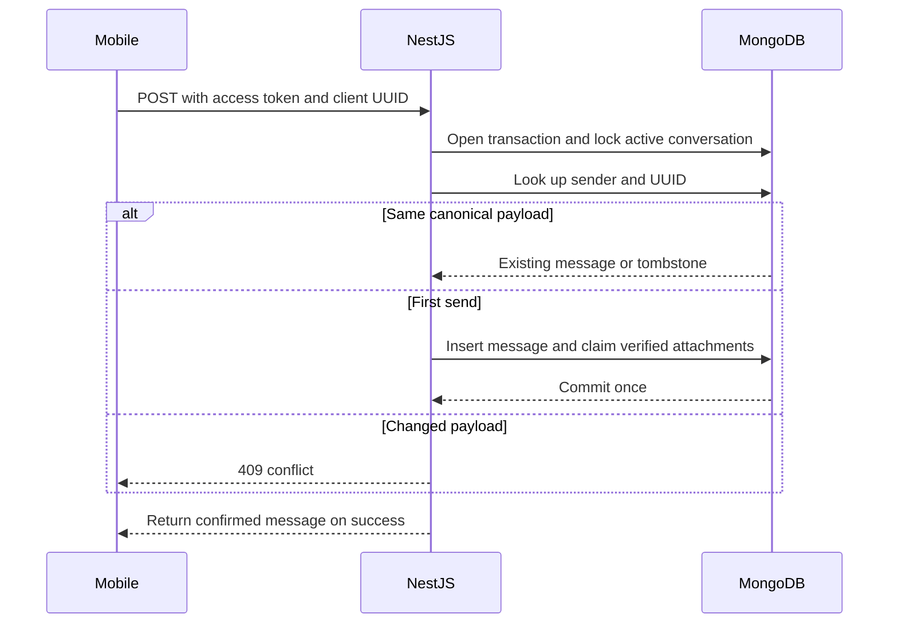
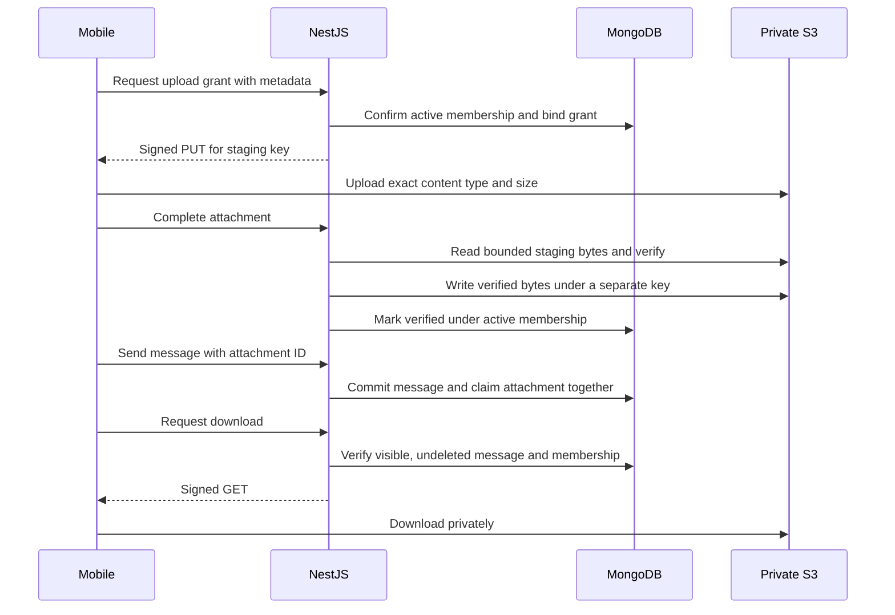

# Messaging architecture

Stage 5 implements the authenticated REST slice of the [system architecture](ARCHITECTURE.md). Messages live in MongoDB and attachment bytes live in a private S3-compatible bucket. Clients refresh on navigation or on demand.

Shared Zod contracts validate request bodies, query parameters, IDs and client responses. The Stage 4 guard authenticates every route. Domain services authorize membership and business operations before repositories read or mutate persistent records. The API returns explicit public projections and the existing error envelope. Account scope remains the pair of backend origin and user ID.

## Conversation and membership

| Action                                                | Owner | Admin | Member | Non-member |
| ----------------------------------------------------- | ----- | ----- | ------ | ---------- |
| View conversation, active members and visible history | Yes   | Yes   | Yes    | No         |
| Send or request a download for a visible message      | Yes   | Yes   | Yes    | No         |
| Delete own visible message                            | Yes   | Yes   | Yes    | No         |
| Add or remove ordinary members                        | Yes   | Yes   | No     | No         |
| Promote, demote or remove an administrator            | Yes   | No    | No     | No         |
| Demote or remove the group owner                      | No    | No    | No     | No         |

Direct conversations have exactly two participant IDs in canonical sorted order. A unique conversation identity key arbitrates races. Group creation uses an owner-specific UUID and a hash of title and sorted initial members. Conversation and initial memberships commit together. Groups are capped at 32 active members. This stage keeps the original owner for the life of a group.

The conversation revision is incremented transactionally by mutations and download grant issuance to serialize against membership changes. A newly invited or re-added member starts at the next message sequence. Existing role changes preserve the original boundary. History, search, previews and attachment grants apply the current membership boundary. An in-flight snapshot read can finish after a concurrent removal. Subsequent requests observe removal.

## Creating a text message

The stored SHA-256 fingerprint binds conversation ID, trimmed body and ordered attachment IDs. One database key on sender and client UUID controls duplicates across all conversations. Prisma unique-key or transaction write conflicts retry against a fresh snapshot, within a bounded number of attempts. A client that loses a committed response resubmits the same payload and UUID. Sender-only deletion clears body and attachment references on the message row and retains metadata for safe idempotency. A replay of a visible tombstone returns no original content.

History seeks by descending server creation time and descending ObjectId. Search uses the same sort and seek cursor with a conversation-prefixed MongoDB text index. It accepts bounded words or phrases and returns 240-character previews. MongoDB may still sort many matches inside a busy conversation. The server applies a time budget to the text query and caps returned pages at 50.

## Attachment upload and download

Upload URLs expire in 120 seconds and sign type and length. Verified bytes live under a separate random key the uploader cannot overwrite. The API checks length, media type and file signatures or strict UTF-8 text. The bucket is private. The app obtains a 45-second download grant only by asking the API for a visible message attachment. A current eligible recipient may download an attached file. Pending objects stay inaccessible to other users. Deletion and removal block new grants. Previously issued links expire independently, and bytes already downloaded by a recipient cannot be recalled.

## Storage and indexes

| Model          | Constraint or index                                                    | Purpose                                       |
| -------------- | ---------------------------------------------------------------------- | --------------------------------------------- |
| `Conversation` | Unique `identityKey`                                                   | Direct-pair and group-create canonicalization |
| `Membership`   | Unique `(conversationId, userId)`                                      | Stable membership and rejoin boundary         |
| `Membership`   | `(userId, active, conversationId)`, `(conversationId, active, userId)` | Inbox and active member queries               |
| `Message`      | Unique `(senderId, clientMessageId)`                                   | Durable send idempotency                      |
| `Message`      | `(conversationId, createdAt DESC, _id DESC)`                           | Scoped history and preview                    |
| `Message`      | `{ conversationId: 1, body: "text" }`                                  | Text search scoped by conversation equality   |
| `Profile`      | `(discoveryKey, userId)`                                               | Normalized prefix discovery                   |
| `Attachment`   | `(ownerId, state, expiresAt)`                                          | Pending upload accounting                     |

Run `npm run db:push` and then `npm run db:messaging` after deploying schema changes. The second command installs the explicit text index and backfills public discovery keys for existing accounts. The index script is idempotent. MongoDB schema management uses Prisma `db push`.

References: [MongoDB scoped compound text indexes](https://www.mongodb.com/docs/manual/core/indexes/index-types/index-text/limit-number-of-items-scanned-for-text-search/), [Prisma MongoDB connector](https://www.prisma.io/docs/orm/overview/databases/mongodb), [Expo DocumentPicker](https://docs.expo.dev/versions/v58.0.0/sdk/document-picker/).
