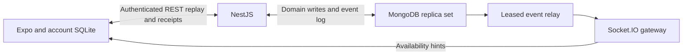
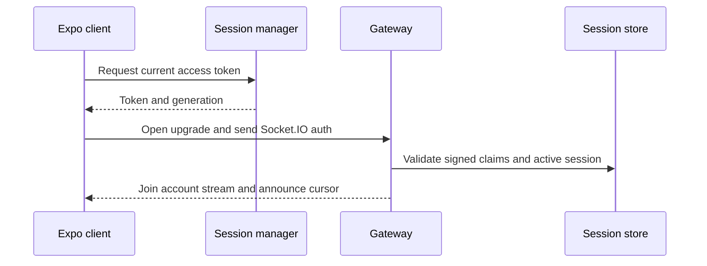
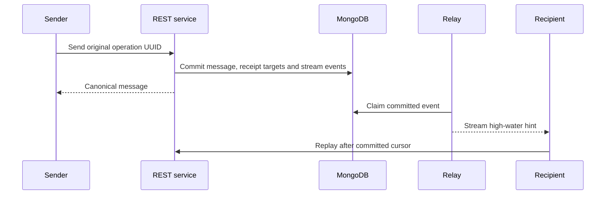
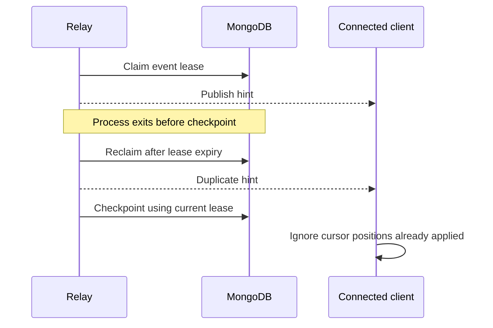
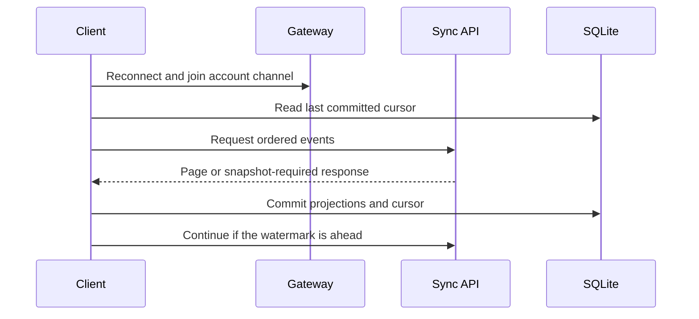
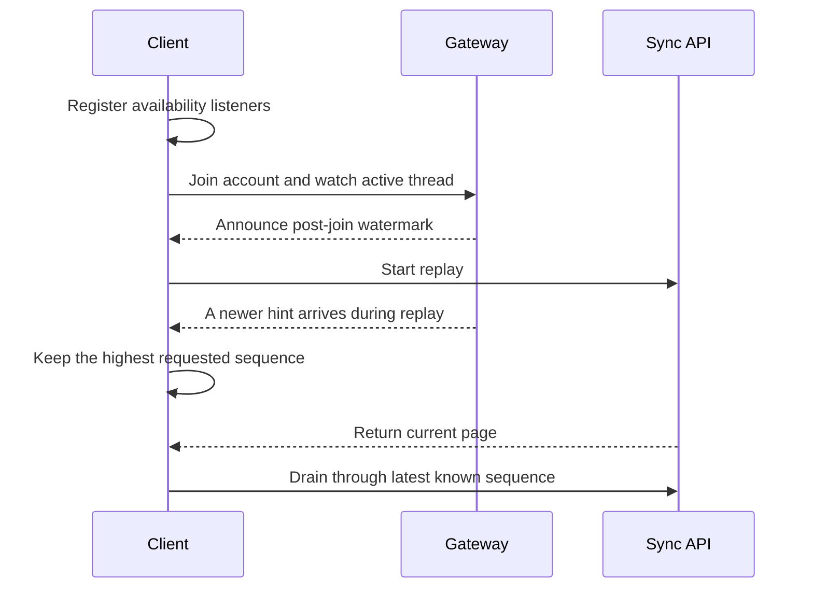
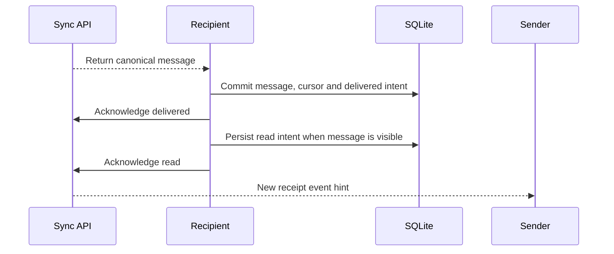
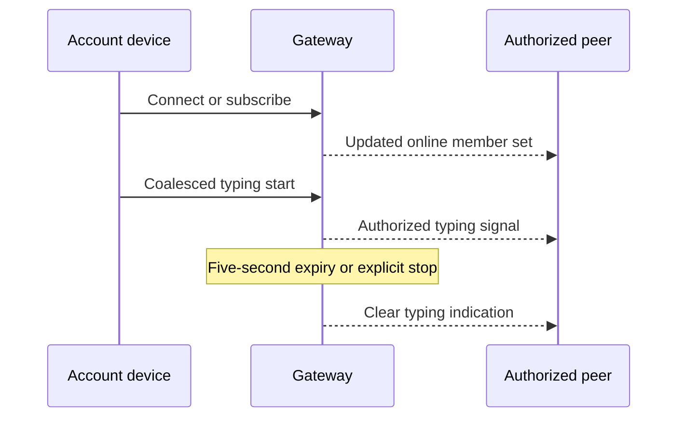
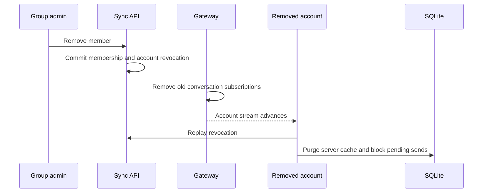

# Stage 7 real-time architecture

Socket messages announce availability. Durable REST replay supplies canonical content. The event and receipt records commit with each domain write. The app applies each contiguous replay page to the existing account SQLite store and commits its cursor in the same transaction.

## Authenticate a connection

## Commit a message and announce it

## Retry relay work after a crash

## Reconnect and replay

## Subscribe during ongoing writes

## Progress delivered and read

## Presence and typing

## Revoke membership

Read [event storage](REALTIME_EVENT_MODEL.md), [replay and retention](EVENT_REPLAY_AND_RETENTION.md), [socket security](SOCKET_SECURITY.md), [receipts](RECEIPT_SEMANTICS.md), and [presence and typing](PRESENCE_AND_TYPING.md) for the deployment contracts.
