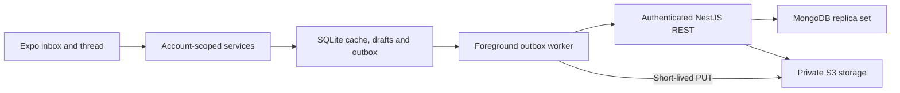
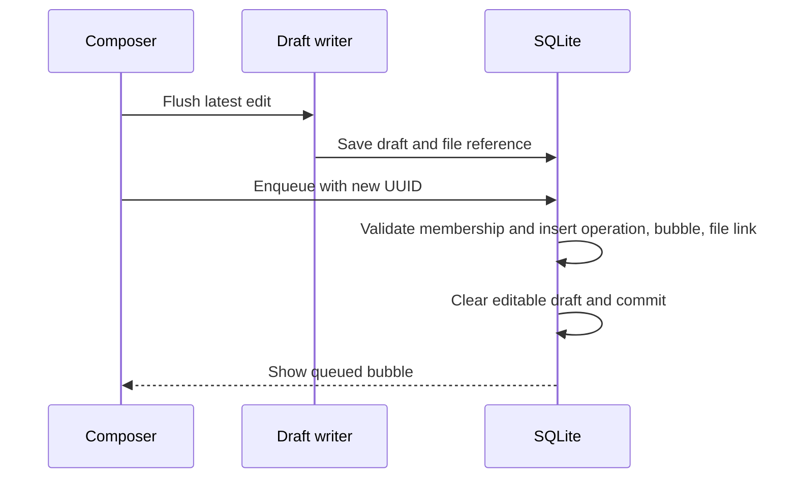
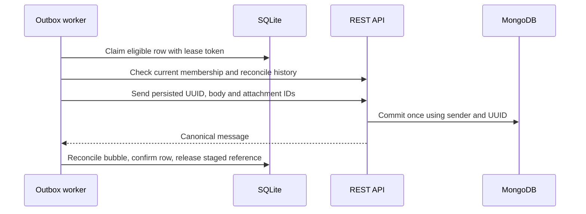
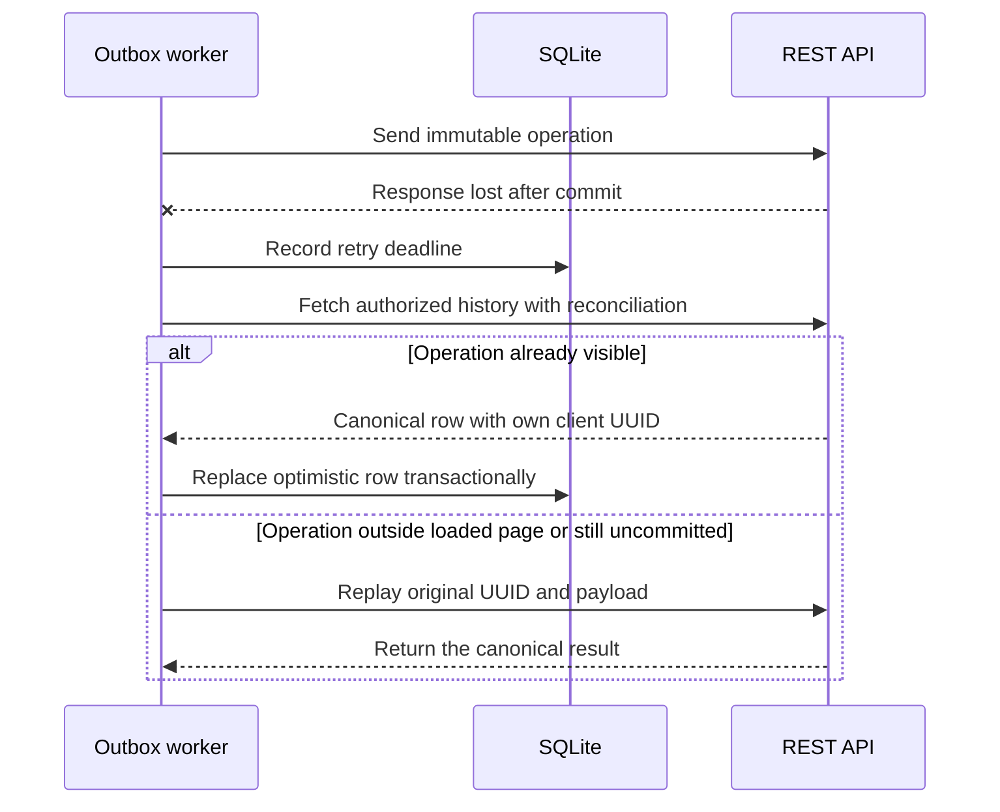
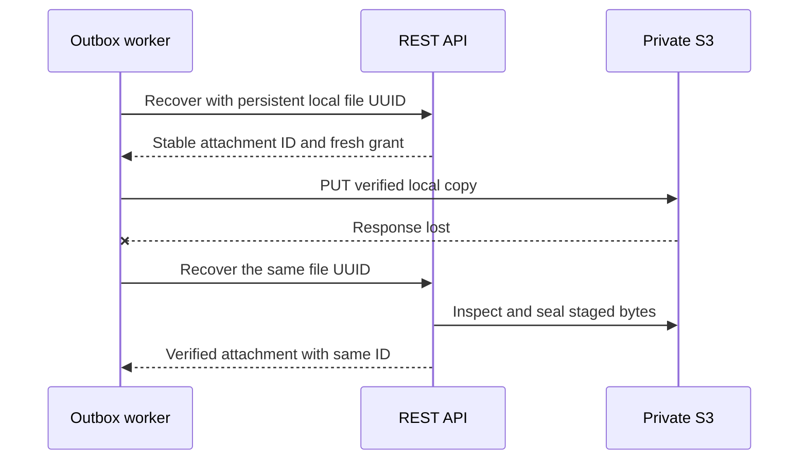
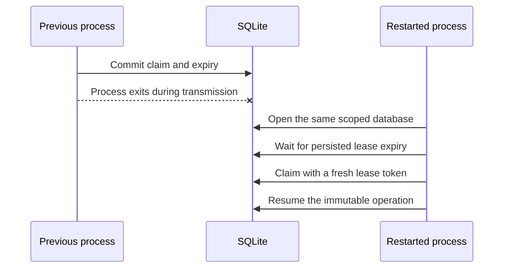
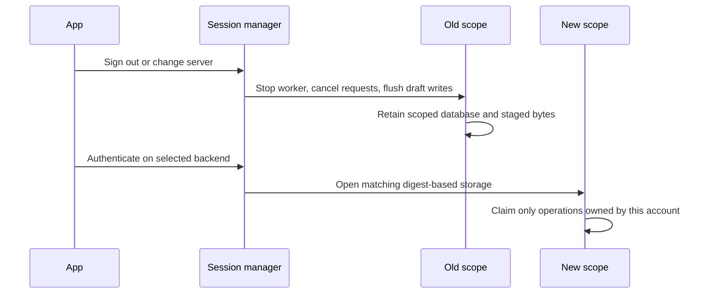

# Stage 6 offline-first reliability

An accepted send starts with a SQLite commit. The outbox, optimistic bubble and editable draft transition share one transaction. MongoDB remains authoritative for acceptance and membership. The existing message UUID, canonical payload fingerprint and unique sender-operation index remain in use.

## Data flow

The scope is the configured backend origin plus the authenticated user ID. The existing scope digest identifies the SQLite database and staged-file directory. SQLite uses WAL, full synchronization, foreign keys, a busy timeout and serialized connection access. Database version 2 applies to account stores. Version 1 shared settings and diagnostics remain readable. Opening locks or write failures leave previously committed records intact.

The account database holds conversations, members, messages, drafts, outbox operations, staged-file metadata, attachment links and sync metadata. A previously authenticated account can read its local cache after a transient cold-start authentication error when the secure session still matches that account and origin. Explicit credential rejection or sign-out closes this fallback. Network operations continue through the same session manager and need a usable server token.

## Queue a text message

Text edits coalesce at 180 ms. Navigation, backgrounding and sending flush pending changes. File selections are copied and verified before the composer acknowledges them. A sudden process kill can still lose the last text changes if SQLite has not committed them. It does not lose an already queued send.

## Send and confirm

## Recover a lost send response

Reconciliation opt-in also returns tombstones and the authorized history boundary. The server includes a client UUID only on messages belonging to the requesting sender. Cached tombstones reject stale content updates. A reported access loss purges the conversation's cached server content and blocks its unsent operations. A changed history boundary discards earlier server history and blocks earlier pending operations. Offline snapshots reflect the last confirmed access. The next successful conversation refresh reconciles them with server authorization.

## Recover an attachment

The app copies selected files to its account document directory and records size and a checksum. A partial copy uses a temporary suffix and only becomes a staged file after validation and rename. Missing or altered bytes produce an actionable durable failure. The server derives the attachment identity from the account, conversation and file operation. It checks ownership, metadata and membership, then refreshes the same pending identity or returns the verified object. Signed URLs and credentials stay out of SQLite. Confirmed operations release staged-file references. Cleanup removes unreferenced local bytes and aged interrupted copies. Failed and access-blocked operations retain their payloads. Framing and checksum checks do not replace a malware scanner.

## Restart and reclaim a lease

Claims use `BEGIN IMMEDIATE`. A 45-second lease renews every 10 seconds during work. Each state transition checks its current lease token and expiry. Lost leases and scope changes cancel further requests. Idempotent endpoints also cover requests that reached the old server before cancellation. Connection failures, timeouts, 408 and 5xx retry using capped exponential backoff with jitter. HTTP 429 preserves the server retry window. A successful foreground refresh advances connection-only waits. Payload conflicts, invalid files and oversized uploads become durable failures. Sign-in and access failures use separate blocked states.

## Switch account or backend

## Deployment and release gate

Deploy the additive API changes before releasing this client. Existing Stage 5 history, upload and send requests retain their original response shapes. Recovery uses `POST /v1/conversations/:id/attachments/recover/:operation` and opt-in `GET /v1/conversations/:id/messages?reconcile=1`. The MongoDB schema and pinned toolchain are unchanged.

Use the [local development guide](LOCAL_DEVELOPMENT.md) for provisioning and the [Stage 6 verification record](STAGE_6_VERIFICATION.md) for test commands and release checks. The worker runs while the app is active and resumes after relaunch or foregrounding. The mobile OS can suspend work in the background. Automatic delivery notifications, recipient receipts and live membership updates belong to Stage 7.
